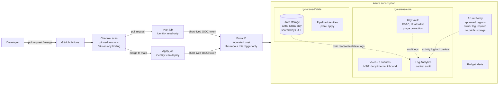
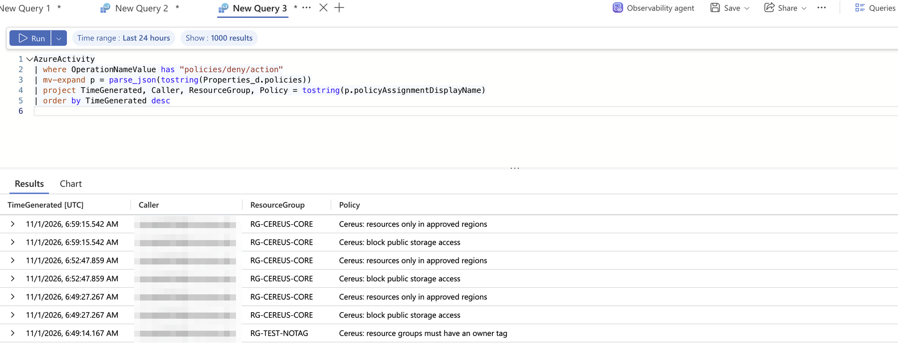
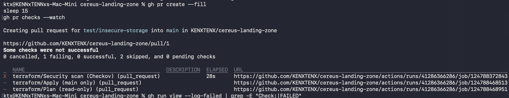
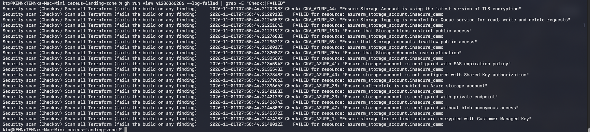

# Cereus Secure Landing Zone — Azure + Terraform

A policy-enforced Azure foundation, built entirely in Terraform and deployed by a **passwordless** GitHub Actions pipeline with a security gate. Every control was proven by attacking it.

> Built as Project 1 of my cloud security portfolio. It is the foundation that my other projects (identity lab, secure AI gateway, AI agent security lab) deploy onto.

---

## The problem

Small and mid-size companies set up cloud fast and insecurely: public storage, no audit trail, master keys shared around, and long-lived deployment passwords sitting in CI systems. Most breaches start with exactly those gaps.

This project is the opposite: a starting environment where insecure resources **cannot** be created, every change is **logged with who made it**, and nothing in the delivery pipeline holds a password.

## What it builds

| Layer | What it does |
|---|---|
| **Secure state storage** | Terraform state in Azure Storage: geo-redundant (GRS), versioned, TLS 1.2, no anonymous access, **shared keys disabled** — every access is an Entra ID identity |
| **Network** | VNet split into app, data, and private-endpoint subnets, each behind an NSG that denies internet inbound; no implicit outbound internet |
| **Key Vault** | Entra RBAC (no legacy access policies), IP allowlist, soft delete, **purge protection**, every secret operation audit-logged |
| **Central logging** | Log Analytics workspace receiving the subscription Activity Log, Key Vault audit logs, and **every read/write of the Terraform state file** |
| **Guardrails (Azure Policy)** | Deny resources outside approved regions, deny resource groups without an `owner` tag, deny storage with public access |
| **Cost guardrail** | Monthly budget in code, alerts at 50% actual and 100% forecasted |
| **Pipeline** | GitHub Actions with OIDC federation (no secrets), pinned Checkov gate, separate read-only *plan* and write *apply* identities |

## Architecture



## Build it, then break it

Every control was attacked to prove it works.

| # | Attack / test | Result | Evidence |
|---|---|---|---|
| 1 | Create a resource group with no `owner` tag | 🔴 **Denied** by policy | [policy denials log](screenshots/03-policy-denials-log.png) |
| 2 | Create a storage account in a non-approved region | 🔴 **Denied** by policy | same |
| 3 | Create a storage account with public blob access | 🔴 **Denied** by policy | same |
| 4 | Create a compliant resource group (`owner` tag, approved region) | 🟢 **Created** — guardrails don't block legitimate work | CLI output |
| 5 | Read Terraform state with the storage **account key** | 🔴 **Rejected**: `KeyBasedAuthenticationNotPermitted` | CLI output |
| 6 | Read Terraform state with my **Entra ID identity** | 🟢 **Allowed**, attributable to a named user | CLI output |
| 7 | Open a PR adding a storage account with public access, HTTP allowed, TLS 1.0 | 🔴 **Blocked in CI** — 11 Checkov findings; plan and apply never ran | [PR checks](screenshots/04-pr-blocked.png), [findings](screenshots/05-ci-checkov-findings.png) |
| 8 | Pipeline deploys `main` | 🟢 Signs in to Azure with **no stored password or key** | GitHub Actions run |

Every policy denial lands in the central workspace with the caller's identity and timestamp:



A pull request that tried to sneak in insecure storage never got past the security gate:





## Findings and decisions

Security engineering is mostly judgment. Highlights from [`docs/findings.md`](docs/findings.md):

- **Shared keys on state storage** gave full access with no per-user audit trail → migrated Terraform and users to Entra ID auth, then disabled shared keys. Verified both directions.
- **Checkov triage:** 9 findings → 3 fixed (purge protection, geo-redundant state, state-file access logging), 6 accepted with written reasons in the code. Scan: 34 passed, 0 failed, 6 documented exceptions.
- **A local scan silently skipped the graph-based (CKV2) checks** that the pinned CI environment ran → the pipeline, not a laptop, is the authoritative gate.
- **The public-storage policy also denies requests that *omit* the setting** — insecure-by-omission is blocked, not just insecure-by-choice.
- **GitHub OIDC tokens carry immutable owner/repo IDs** → trust rules match those IDs, so a deleted or renamed repo name can't be reclaimed by someone else to reach Azure.
- **Identity-dependent code:** the Key Vault admin role was assigned to "whoever runs Terraform," which would have swapped the human admin for the pipeline identity on the first CI run → pinned to an explicit object ID.

Full threat model: [`docs/threat-model.md`](docs/threat-model.md)

## How the passwordless pipeline works

1. GitHub issues the job a short-lived OIDC token describing exactly which repo and trigger it is.
2. Azure only trusts that token if it matches a federated credential: `pull_request` for the **plan** identity, `refs/heads/main` for the **apply** identity.
3. The plan identity is **Reader** plus state access. It can look, never change.
4. The apply identity can deploy, with role-assignment rights limited to one resource group.
5. Nothing long-lived exists to leak. There is no client secret anywhere.

## Repo layout

```
bootstrap/          State storage + pipeline identities (run locally, once)
landing-zone/       Network, Key Vault, logging, policy, budget (deployed by CI)
.github/workflows/  Checkov gate -> plan (PRs) -> apply (main)
queries/            KQL used to prove controls work
docs/               Findings log and threat model
screenshots/        Evidence
```

## Run it yourself

```
# 1. Bootstrap (once, locally)
cd bootstrap
export TF_VAR_subscription_id=$(az account show --query id -o tsv)
terraform init && terraform apply

# 2. Landing zone (locally the first time; CI after that)
cd ../landing-zone
export TF_VAR_allowed_ip=$(curl -s https://api.ipify.org)
export TF_VAR_alert_email="you@example.com"
export TF_VAR_admin_object_id=$(az ad signed-in-user show --query id -o tsv)
export TF_VAR_state_storage_account_name=$(cd ../bootstrap && terraform output -raw storage_account_name)
terraform init -backend-config="storage_account_name=$TF_VAR_state_storage_account_name"
terraform apply
```

## Cost

Designed to run for close to $0 in a lab: VNets and NSGs are free, Key Vault bills per operation, log ingestion is capped at 1 GB/day, and the budget alert watches the rest. Private endpoints were deliberately deferred partly for cost (see findings).

## What's next

- Private endpoints for Key Vault and state storage, with self-hosted runners inside the VNet
- Alert rule on policy denials (the KQL already exists in `queries/`)
- Move the bootstrap state off my laptop
- Projects 2–7 deploy onto this foundation: identity lab, cost leak finder, secure AI gateway, AI alert triage, AI agent security lab, field QC

## Skills demonstrated

Terraform · Azure Policy · Entra ID RBAC · Workload identity federation (OIDC) · GitHub Actions · Checkov / policy-as-code · Key Vault · Log Analytics / KQL · Network security groups · Threat modeling · Security finding triage
